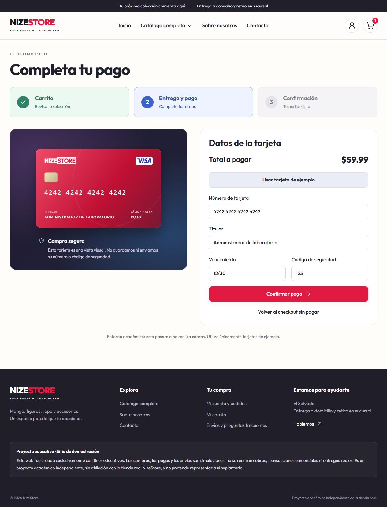
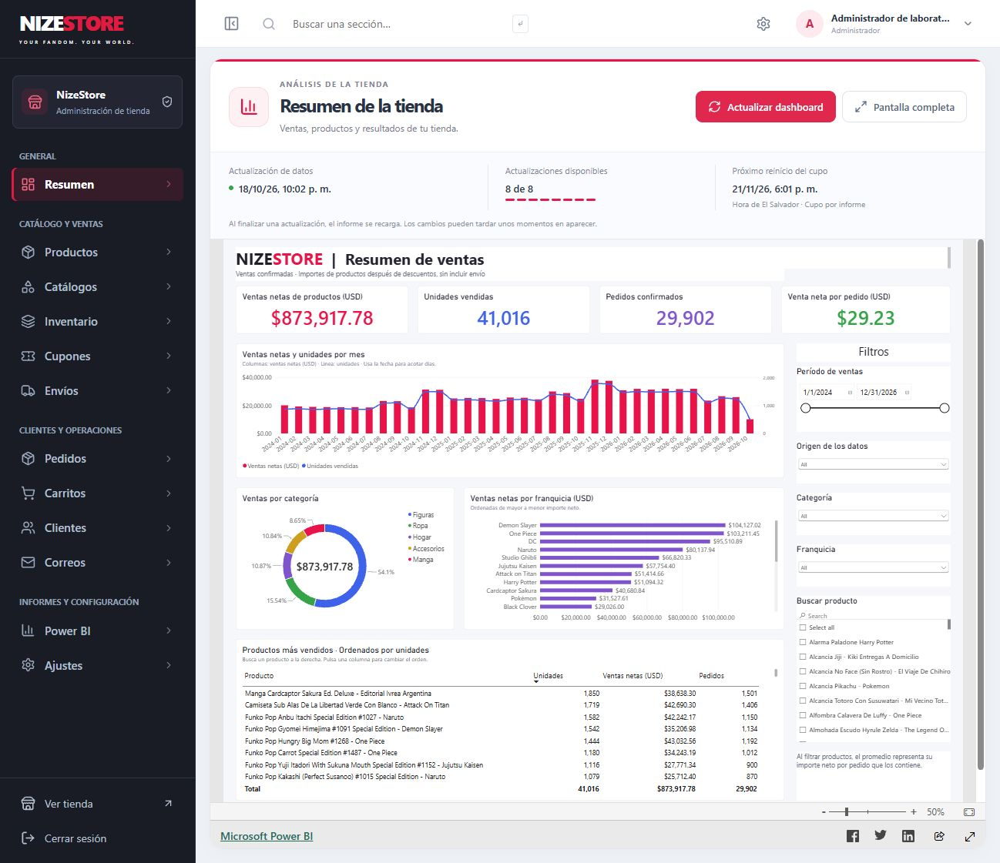
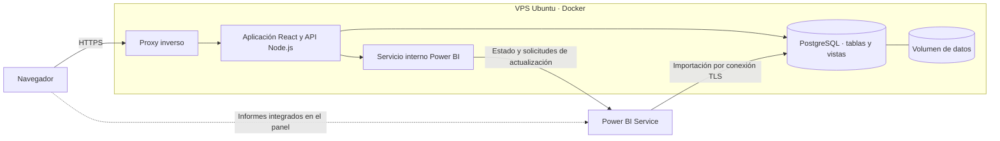
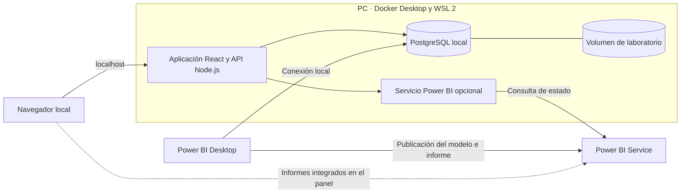

# Caso de estudio: abandono de compra en e-commerce

**Power BI · PostgreSQL · SQL · Docker**

En este proyecto analicé el recorrido de compra de un e-commerce simulado: desde que se agregan productos al carrito hasta que se confirma un pedido. Mi objetivo fue entender dónde se concentra el abandono y cómo se relacionan el subtotal, el costo de envío mostrado y el umbral de envío gratuito con la continuidad de la compra.

Lo desarrollamos como trabajo universitario en grupo. Diseñamos el modelo de datos y el enfoque de análisis; utilizamos IA para agilizar la demo web, generar datos simulados y apoyar la escritura de los scripts SQL. En este repositorio presento el problema, los informes, los hallazgos de la simulación y las recomendaciones que se pueden plantear con esos datos.

> **Caso académico independiente.** Las operaciones y los datos de clientes son simulados; no corresponden a una empresa real. Las marcas que aparecen en las pantallas forman parte del prototipo académico y no implican afiliación. No se realizan cobros ni entregas reales.

## El problema

El escenario de la simulación plantea un aumento del abandono: del 30 % en el período histórico al 55 % en julio-septiembre de 2026. Ante esa diferencia, interesa revisar el recorrido de compra antes de decidir si conviene cambiar la política de envío gratuito.

Para estudiar el problema, acoté el análisis a las etapas de compra, los importes mostrados, el umbral de envío gratuito, el tipo de cliente y la evolución temporal. No busco demostrar causas técnicas ni calcular rentabilidad con datos que este enfoque no mide.

## Pregunta principal

**¿En qué etapas se abandona la compra, y cómo se relacionan el subtotal y el costo de envío mostrado, incluido el umbral de envío gratuito, con la finalización del pedido?**

### Preguntas secundarias

1. ¿Cómo evoluciona la cantidad y proporción de carritos con abandono?
2. ¿En qué etapas se concentra el abandono?
3. ¿Qué proporción llega al checkout, inicia el pago y confirma un pedido?
4. ¿Cómo varían abandono y conversión por debajo, exactamente en y por encima del umbral de envío gratuito?
5. ¿Cómo se relaciona el costo de envío mostrado con la continuidad de la compra?
6. ¿Qué diferencias aparecen entre clientes nuevos y recurrentes, y entre períodos?
7. ¿Cuántos carritos con abandono terminan convirtiéndose posteriormente?

## Cómo trabajé el análisis

Organicé los datos operativos en PostgreSQL y utilicé cinco vistas analíticas como entrada de Power BI. En Power Query se preparan los tipos, las fechas y los importes de análisis; en DAX se calculan abandono, avance, conversión y recuperación.

Para comparar el envío, conservo lo que se mostró al abandonar y separo entrega a domicilio, retiro y cotizaciones desconocidas. También distingo el estado actual de un carrito de haber abandonado alguna vez: un carrito puede abandonar y después comprar.

Los hallazgos siguientes se recalcularon el **21 de noviembre de 2026** sobre los **42,900 carritos del histórico simulado**, mediante consultas de solo lectura con las reglas del modelo. Las capturas muestran los informes publicados en Power BI integrados dentro del panel de administración.

## Hallazgos principales

La columna de fuente indica dónde se observa cada resultado en el dashboard **Carritos y abandono de compra**, con origen HISTORICO_SIMULADO. Uso el redondeo visible del informe; cuando calculo una proporción a partir de sus conteos, lo indico.

| Fuente visual | Hallazgo en la simulación | Lectura del resultado |
|---|---|---|
| Barras horizontales «¿En qué etapa abandonan?» y tarjeta «Carritos con abandono» | Checkout concentra 10,107 de los 14,245 carritos con abandono: 70.95 %, calculado a partir de esos conteos | Es la etapa que conviene revisar primero; el gráfico no identifica el motivo del abandono |
| Gráfico combinado «Carritos con abandono y convertidos por mes» | La tasa pasa del 30.0 % histórico al 55.0 % en julio-septiembre de 2026 | El cambio es de 25 puntos porcentuales y forma parte del escenario sintético |
| Columnas agrupadas «Abandono y conversión por subtotal» | El abandono es 32.9 % entre $25 y $34.99, frente a 25.5 % por debajo de $25 y 21.3 % desde $35 | El rango intermedio tiene la mayor tasa, no necesariamente el mayor número de compras |
| Columnas agrupadas «Comparación con el umbral de envío gratuito» | La conversión es 72.7 % por debajo del umbral y 82.3 % por encima | La diferencia orienta una prueba comercial; no mide el efecto de cambiar la política |
| Tarjetas «Llegan al checkout», «Inician el pago» y «Conversión a pedido» | Llega al checkout el 92.2 % de los carritos; inicia el pago y confirma un pedido el 69.7 % | En este histórico no se representa pérdida entre inicio de pago y confirmación |
| Columnas agrupadas «Continuidad según el costo de envío mostrado» | La conversión es 82.3 % con envío de $0; entre las tarifas cobradas no disminuye de forma continua al aumentar el precio | Hay una asociación con envío gratuito, pero no una relación simple entre precio y conversión |
| Barras horizontales agrupadas «Clientes nuevos y recurrentes» | Abandono de 33.6 % en nuevos y 32.8 % en recurrentes | La diferencia global es pequeña; conviene cruzarla con período y subtotal antes de segmentar campañas |
| Tarjetas «Carritos recuperados» y «Tasa de recuperación» | 2,540 carritos compraron después de abandonar: 17.8 % de los que tuvieron abandono | El abandono puede ser transitorio; recuperación y conversión deben medirse por separado |

Los gráficos de subtotal, umbral y costo de envío comparan entrega a domicilio con cotización conocida. Abandono y conversión pueden solaparse: un carrito puede aparecer en ambos grupos si abandona y después compra. Las barras comparativas son **agrupadas**, no partes apiladas de un 100 %.

La ausencia de casos exactamente en el umbral se comprobó en los datos; no se interpreta la ausencia de una barra como una tasa de cero. El detalle de cada pregunta, los conteos y sus fuentes está en [Hallazgos y recomendaciones](docs/HALLAZGOS_Y_RECOMENDACIONES.md).

## Recomendaciones de negocio

- **Probar envío gratis desde $25 en un piloto acotado.** El rango de $25 a $34.99 tiene la mayor tasa de abandono por subtotal. Compararía la política de $35 con una promoción de $25 en grupos equivalentes, midiendo conversión, costo de envío asumido y margen de contribución por pedido. La comparación actual no garantiza que el cambio sea rentable.
- **Dar claridad al total antes del checkout.** Mostrar el costo de envío y cuánto falta para el beneficio permite evaluar si una comunicación más temprana mejora el avance en la etapa que concentra el abandono.
- **Probar combinaciones de productos para alcanzar el beneficio.** Para carritos menores de $25, evaluaría sugerencias pertinentes que acerquen el subtotal al umbral, midiendo aceptación, importe por pedido y margen, sin asumir que una compra más alta siempre sea mejor.
- **Evaluar recuperación de carritos con seguimiento propio.** Mediría pedidos confirmados después de recordatorios autorizados, comparándolos con un grupo sin intervención. Los 2,540 recuperados muestran que existe retorno a la compra; no prueban que un mensaje lo haya causado.

Son decisiones para probar en el escenario de negocio, con métricas y límites definidos. El [documento de recomendaciones](docs/HALLAZGOS_Y_RECOMENDACIONES.md) explica cómo evaluarlas.

## Recorrido visual

### E-commerce

**Inicio y categorías.** La cabecera, la presentación y las categorías muestran cómo empieza el recorrido de compra.

**Catálogo.** Búsqueda, filtros por categoría y precio, disponibilidad y acceso al carrito.

**Pago simulado.** La tarjeta visual responde a los campos del formulario. La captura utiliza la tarjeta de ejemplo de la aplicación; no se confirmó ningún pago.

### Administración y análisis con Power BI

**Productos.** Vista de gestión del catálogo con categorías, variantes, precios y existencias.

**Pedidos.** Consulta de pedidos, estados de entrega y cobro del histórico simulado.

**Carritos.** Seguimiento de las etapas y consulta del historial de abandono. El panel distingue episodios de abandono, carritos distintos con historial y estado actual.

**Resumen de ventas integrado.** El dashboard de Power BI se consulta directamente en Resumen de la tienda, conservando la navegación del administrador.

**Carritos y abandono integrado.** El segundo dashboard se consulta desde la sección Power BI. En esta captura seleccioné el origen HISTORICO_SIMULADO y ajusté el informe completo dentro de su marco.

Las capturas se tomaron el 21/11/2026. Los informes permiten explorar los datos mediante filtros y muestran la fecha de actualización del modelo publicado.

**VPS y entorno local.** En el despliegue en VPS, PostgreSQL actúa como origen de los informes publicados en Power BI. Para trabajar en la PC, el modelo se configura con la conexión al PostgreSQL local. Los datos del informe cambian al actualizar el modelo; abrir el panel muestra la versión publicada en Microsoft. El detalle de ambas configuraciones está en [Arquitectura y operación](docs/ARQUITECTURA_Y_OPERACION.md).

Resumen conserva el origen «Todas» y muestra 29,902 pedidos de la importación anterior. Carritos está filtrado al histórico y muestra 42,900 carritos, 14,245 con abandono y 2,540 recuperados. Las tablas de hallazgos usan la comprobación SQL local; las diferencias de detalle se explican en [Evidencias](docs/EVIDENCIAS.md).

### Aviso académico

Las marcas y referencias visuales pertenecen al antecedente académico. Los nombres, pedidos y operaciones visibles son datos de laboratorio, sin actividad comercial real.

## Tecnologías y arquitectura

| Área | Tecnologías y función |
|---|---|
| Análisis | Power BI, Power Query y DAX: preparación, relaciones, filtros e indicadores |
| Datos | PostgreSQL 18 y SQL: operación, vistas y población sintética |
| Aplicación | React, TypeScript, Vite, Node.js y Express: recorrido de compra y administración |
| Entorno | Docker Compose, Docker Desktop y WSL 2: ejecución local de aplicación y base |

### Despliegue en VPS

La VPS Ubuntu ejecuta los contenedores de aplicación, PostgreSQL y servicio interno Power BI. Un proxy recibe las conexiones HTTPS; Power BI Service importa las vistas de PostgreSQL y el panel muestra los informes publicados.

### Ejecución local

En la PC, Docker Desktop y WSL 2 ejecutan aplicación y base. Power BI Desktop se conecta al PostgreSQL local para preparar y actualizar el modelo. El panel puede mostrar los informes publicados y consultar su estado con el servicio interno opcional.

Docker Compose coordina los servicios; los volúmenes conservan los datos. En ambos entornos los informes usan modo Import: los datos cambian al actualizar el modelo. Más detalles en [Arquitectura y operación](docs/ARQUITECTURA_Y_OPERACION.md).

## Mi participación y aprendizajes

Diseñamos en grupo la base de datos: qué tablas necesitábamos, cómo se relacionaban y qué información debía conservarse para responder las preguntas. Utilizamos IA como apoyo para escribir el script SQL a partir de ese diseño, generar la población sintética y construir con rapidez la página web de demostración.

En las prácticas y en este proyecto aprendí a aplicar Power BI a un caso de negocio: conectar PostgreSQL directamente, importar y exportar CSV, limpiar y transformar datos en Power Query, crear columnas personalizadas y calculadas, definir medidas DAX y diseñar dashboards con filtros e indicadores. También practiqué el uso de una VPS Ubuntu, Docker Compose y volúmenes para ejecutar los servicios.

Mi aporte se centra en el diseño y la comprensión del caso, la preparación de datos y la interpretación de los indicadores. El desarrollo recibió asistencia de IA y revisión del grupo; la documentación también se preparó con ese apoyo. Detallo las actividades y sus evidencias en [Participación y aprendizajes](docs/PARTICIPACION.md).

## Documentación y estado

- [Hallazgos y recomendaciones](docs/HALLAZGOS_Y_RECOMENDACIONES.md)
- [Datos, definiciones y reglas del análisis](docs/DATOS_E_INDICADORES.md)
- [Capturas, fuentes y validaciones](docs/EVIDENCIAS.md)
- [Arquitectura y operación](docs/ARQUITECTURA_Y_OPERACION.md)

Este repositorio contiene la presentación del caso y tablas agregadas de la simulación. La implementación completa permanece privada. La aplicación se ejecuta en local con ambos informes publicados integrados y consulta de su estado. La conexión de datos de Power BI se configura según el entorno utilizado: VPS o PostgreSQL local.

Las marcas y recursos de terceros visibles en las capturas no se atribuyen como creación propia ni reciben una licencia abierta mediante este repositorio.
