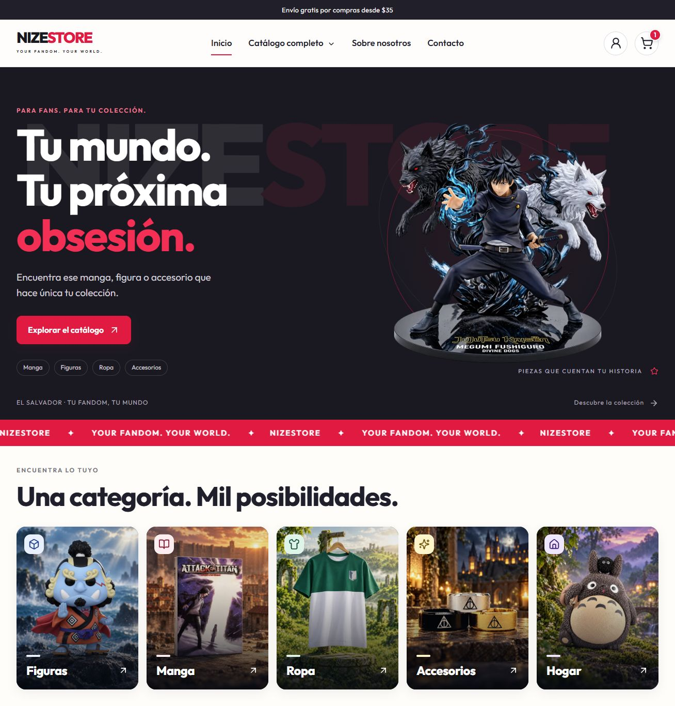
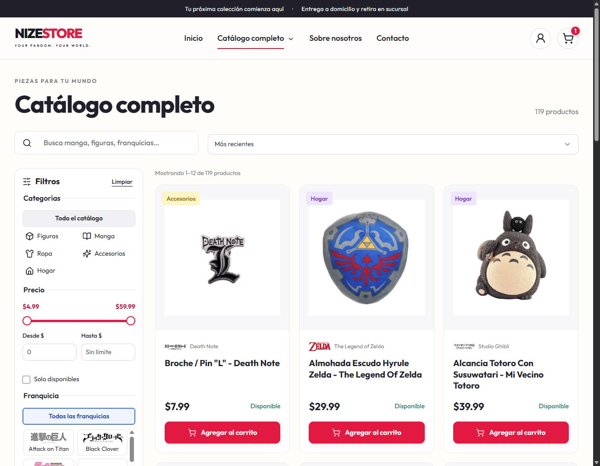
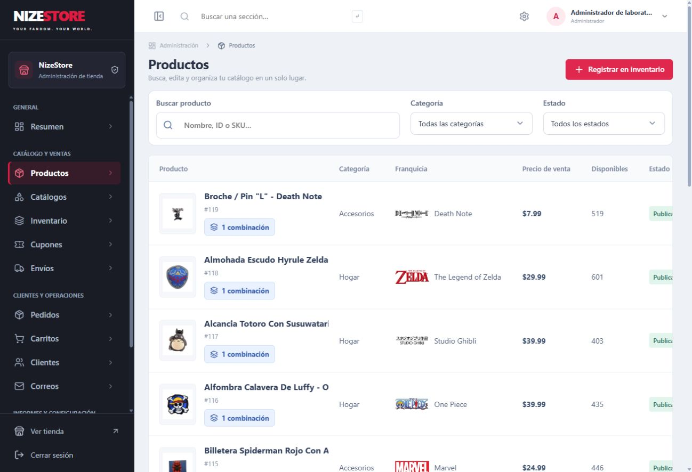
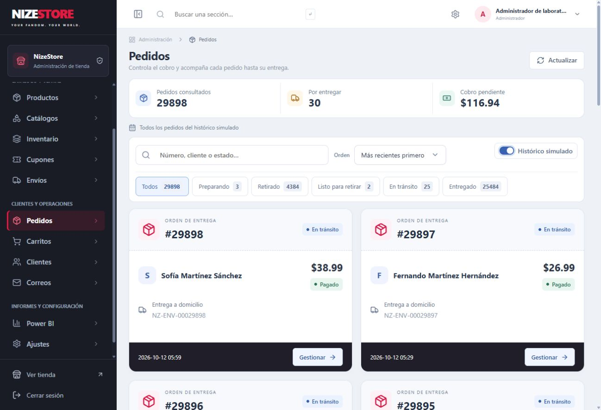
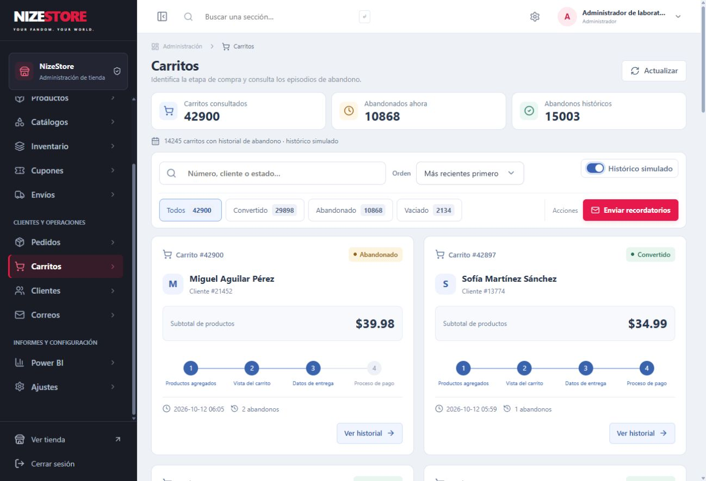
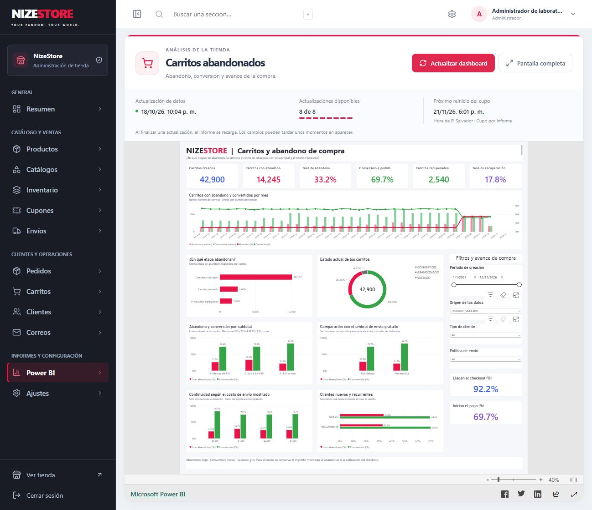
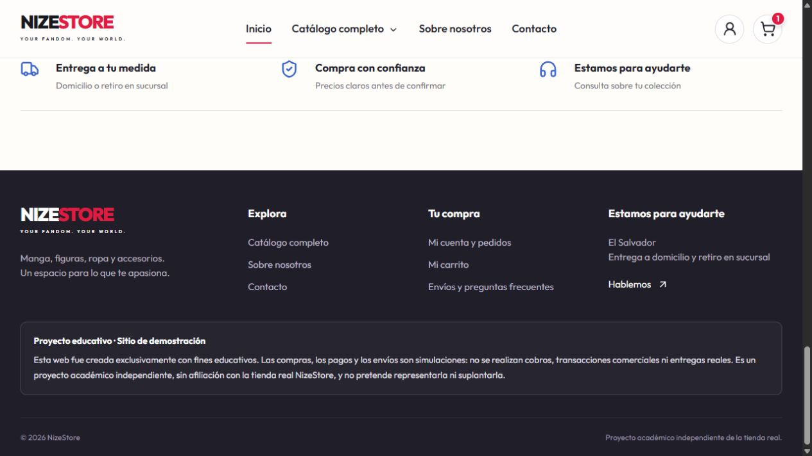
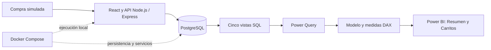

# Caso de estudio: abandono de compra en e-commerce

**Power BI · PostgreSQL · SQL · Docker**

En este proyecto analicé el recorrido de compra de un e-commerce simulado: desde que se agregan productos al carrito hasta que se confirma un pedido. Mi objetivo fue entender dónde se concentra el abandono y cómo se relacionan el subtotal, el costo de envío mostrado y el umbral de envío gratuito con la continuidad de la compra.

Lo desarrollamos como trabajo universitario en grupo, con amplia asistencia de IA. En este repositorio presento el problema, los informes, los hallazgos de la simulación y las recomendaciones que se pueden plantear con esos datos.

> **Caso académico independiente.** Las operaciones y los datos de clientes son simulados; no corresponden a una empresa real. Las marcas que aparecen en las pantallas forman parte del prototipo académico y no implican afiliación. No se realizan cobros ni entregas reales.

## El problema

El escenario de la simulación plantea un aumento del abandono: del 30 % en el período histórico al 55 % en julio-septiembre de 2026. Ante esa diferencia, interesa revisar el recorrido de compra antes de decidir si conviene cambiar la política de envío gratuito.

Para estudiar el problema, acoté el análisis a las etapas de compra, los importes mostrados, el umbral de envío gratuito, el tipo de cliente y la evolución temporal. No busco demostrar causas técnicas ni calcular rentabilidad con datos que este enfoque no mide.

## Pregunta principal

**¿En qué etapas se abandona la compra, y cómo se relacionan el subtotal y el costo de envío mostrado, incluido el umbral de envío gratuito, con la finalización del pedido?**

### Preguntas secundarias

1. ¿Cómo evoluciona la cantidad y proporción de carritos con abandono?
2. ¿En qué etapas se concentra el abandono?
3. ¿Qué proporción llega al checkout, inicia el pago y confirma un pedido?
4. ¿Cómo varían abandono y conversión por debajo, exactamente en y por encima del umbral de envío gratuito?
5. ¿Cómo se relaciona el costo de envío mostrado con la continuidad de la compra?
6. ¿Qué diferencias aparecen entre clientes nuevos y recurrentes, y entre períodos?
7. ¿Cuántos carritos con abandono terminan convirtiéndose posteriormente?

## Cómo trabajé el análisis

Organicé los datos operativos en PostgreSQL y utilicé cinco vistas analíticas como entrada de Power BI. En Power Query se preparan los tipos, las fechas y los importes de análisis; en DAX se calculan abandono, avance, conversión y recuperación.

Para comparar el envío, conservo lo que se mostró al abandonar y separo entrega a domicilio, retiro y cotizaciones desconocidas. También distingo el estado actual de un carrito de haber abandonado alguna vez: un carrito puede abandonar y después comprar.

Los hallazgos siguientes se recalcularon el **21 de noviembre de 2026** sobre los **42.900 carritos del histórico simulado**, mediante consultas de solo lectura con las reglas del modelo. Las imágenes Power BI muestran los informes publicados dentro del panel local, con su menú administrativo. La integración de visualización y consulta de estado está restaurada; esto no acredita sincronización de los modelos con la base local actual.

## Hallazgos principales

| Hallazgo en la simulación | Lectura del resultado |
|---|---|
| El 70,95 % de los carritos con abandono lo registra en checkout: 10.107 de 14.245 | Es la etapa que conviene revisar primero; el dato no identifica por sí solo el motivo |
| El 92,18 % llega al checkout y el 69,69 % inicia el pago y confirma un pedido | La simulación permite observar el avance, pero no contiene pérdida entre inicio del pago y confirmación en este histórico |
| Con envío a domicilio cotizado, la conversión es 72,70 % por debajo del umbral y 82,34 % por encima | Existe una asociación descriptiva; no demuestra que bajar el umbral produzca esa mejora |
| No hay carritos exactamente en el umbral | No puedo concluir qué ocurre en ese punto sin incorporar casos de prueba |
| 2.540 carritos compraron después de abandonar: 17,83 % de los carritos con abandono | Abandono no siempre significa pérdida definitiva de la compra |

El cambio del 30 % al 55 % forma parte del diseño del generador de datos. Es útil para practicar la detección y lectura de un cambio, pero no es evidencia de un deterioro comercial real.

En [Hallazgos y recomendaciones](docs/HALLAZGOS_Y_RECOMENDACIONES.md) desarrollo las siete preguntas, sus denominadores y los límites de cada conclusión.

## Recomendaciones

- **Priorizar la revisión del checkout:** comprobar claridad del total, información de entrega y pasos necesarios. Después medir si los cambios mejoran la continuidad; la concentración de abandono no prueba que exista un error de interfaz.
- **Hacer visible la política de envío:** mostrar costo y distancia al umbral antes de que el usuario avance. Un piloto con costos y margen permitiría evaluar un cambio de umbral; esta simulación no basta para recomendar una rebaja permanente.
- **Medir la recuperación por separado:** contar pedidos confirmados después del abandono, sin confundir un regreso al carrito con una venta recuperada.
- **Completar los casos faltantes:** añadir valores exactamente en el umbral y escenarios de inicio de pago sin confirmación para ampliar la evaluación.

Son propuestas para evaluar, no acciones con impacto comercial ya demostrado.

## Recorrido visual

### E-commerce

**Inicio y categorías.** La cabecera, la presentación y las categorías muestran cómo empieza el recorrido de compra.

**Catálogo.** Búsqueda, filtros por categoría y precio, disponibilidad y acceso al carrito.

**Pago simulado.** La tarjeta visual responde a los campos del formulario. La captura utiliza la tarjeta de ejemplo de la aplicación; no se confirmó ningún pago.

### Administración y análisis con Power BI

**Productos.** Vista de gestión del catálogo con categorías, variantes, precios y existencias.

**Pedidos.** Consulta de pedidos, estados de entrega y cobro del histórico simulado.

**Carritos.** Seguimiento de las etapas y consulta del historial de abandono. El panel distingue episodios de abandono, carritos distintos con historial y estado actual.

**Resumen de ventas integrado.** El dashboard de Power BI se consulta directamente en Resumen de la tienda, conservando la navegación del administrador.

**Carritos y abandono integrado.** El segundo dashboard se consulta desde la sección Power BI. En esta captura seleccioné el origen HISTORICO_SIMULADO y ajusté el informe completo dentro de su marco.

Las capturas se tomaron el 21/11/2026. Los informes muestran la importación publicada en Microsoft, cuya última actualización completada consultada es del 19/10/2026 UTC. La visualización interactiva y la consulta de fecha/cupo están restauradas; cargar datos nuevos requiere restablecer un origen accesible para Power BI. No se solicitó una actualización de datos para estas capturas.

Resumen conserva el origen «Todas» y muestra 29.902 pedidos de la importación anterior. Carritos está filtrado al histórico y muestra 42.900 carritos, 14.245 con abandono y 2.540 recuperados. Las tablas de hallazgos usan la comprobación SQL local; las diferencias de detalle se explican en [Evidencias](docs/EVIDENCIAS.md).

### Aviso académico

Las marcas y referencias visuales pertenecen al antecedente académico. Los nombres, pedidos y operaciones visibles son datos de laboratorio, sin actividad comercial real.

## Tecnologías y arquitectura

| Área | Tecnologías y función |
|---|---|
| Análisis | Power BI, Power Query y DAX: preparación, relaciones, filtros e indicadores |
| Datos | PostgreSQL 18 y SQL: operación, vistas y población sintética |
| Aplicación | React, TypeScript, Vite, Node.js y Express: recorrido de compra y administración |
| Entorno | Docker Compose, Docker Desktop y WSL 2: ejecución local de aplicación y base |

## Mi participación

Participé principalmente en definir lo que queríamos construir, orientar el diseño y revisar el funcionamiento con apoyo del equipo y de IA. El grupo colaboró en la idea y el modelo de datos. El código y parte del trabajo de Power BI se realizaron con asistencia amplia de IA; no los presento como desarrollo manual individual.

Lo que más me interesa de este caso es relacionar una pregunta de negocio con datos e indicadores, y entender cómo sostener la solución con PostgreSQL y contenedores. Detallo el alcance en [Participación y aprendizajes](docs/PARTICIPACION.md).

## Documentación y estado

- [Hallazgos y recomendaciones](docs/HALLAZGOS_Y_RECOMENDACIONES.md)
- [Datos, definiciones y reglas del análisis](docs/DATOS_E_INDICADORES.md)
- [Capturas, fuentes y validaciones](docs/EVIDENCIAS.md)
- [Arquitectura y operación](docs/ARQUITECTURA_Y_OPERACION.md)

Este repositorio contiene la presentación del caso y tablas agregadas de la simulación. La implementación completa permanece privada. La aplicación funciona en local con ambos informes publicados integrados y consulta de su estado. La nueva demo pública y la actualización de los modelos desde un origen restaurado requieren validación adicional.

Las marcas y recursos de terceros visibles en las capturas no se atribuyen como creación propia ni reciben una licencia abierta mediante este repositorio.
