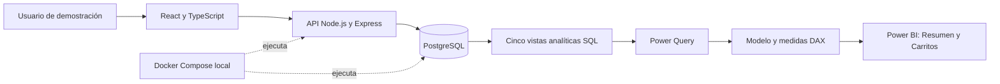

# Caso de estudio: inteligencia de negocios en e-commerce

**PostgreSQL · Power BI · Docker · Análisis de carritos y ventas**

Caso académico que conecta una tienda simulada con datos operativos, vistas SQL e informes de inteligencia de negocios. El interés profesional de Elías García se centra en entender los indicadores y la infraestructura que permite obtenerlos.

> Proyecto universitario grupal, desarrollado con amplia asistencia de IA. Los datos de operaciones son sintéticos y las compras, los pagos y los envíos son simulados. No hay afiliación con ninguna tienda comercial ni resultados de clientes reales.

*Captura real del prototipo local, 20 de noviembre de 2026. Es el panel de administración web, no un informe Power BI. La identidad NizeStore visible pertenece al antecedente académico; este caso no representa a la tienda comercial homónima. Los nombres y operaciones mostrados son datos de laboratorio.*

## Problema y finalidad

Una tienda necesita relacionar sus ventas con el recorrido previo a la compra. Contar pedidos no basta para distinguir cuántos carritos siguen abandonados, cuántos abandonaron alguna vez y cuántos episodios de abandono ocurrieron.

El caso utiliza una simulación para estudiar estas diferencias, organizar datos para análisis y practicar la ejecución de la aplicación y su base mediante contenedores. No fue un encargo comercial ni una intervención sobre una empresa real.

## Preguntas de negocio

- ¿Cómo evolucionan las ventas y las unidades vendidas por período, producto y categoría?
- ¿Cuántos carritos llegan al checkout, inician el pago y terminan en un pedido?
- ¿Qué diferencia hay entre estado actual de abandono y antecedentes de abandono?
- ¿Cómo separar el histórico generado de las nuevas pruebas del prototipo?
- ¿Qué limitaciones introducen las fechas de corte, los datos sintéticos y las cotizaciones desconocidas?

## Arquitectura

La aplicación y PostgreSQL se ejecutaron localmente con Docker Desktop y WSL 2. Los proyectos Power BI se conservan en la implementación privada; actualizar sus datos contra esta instalación y validar los informes Desktop son tareas pendientes. El diagrama describe el recorrido previsto y los componentes existentes, sin afirmar una conexión Microsoft actualmente operativa.

## Resultados técnicos comprobados

| Evidencia | Resultado | Alcance |
|---|---|---|
| Ejecución local en Windows | Aplicación y base saludables | Docker Desktop y WSL 2; acceso web local |
| Catálogo de laboratorio | 119 productos; filtro Manga con 13 | Revisión visual en navegador de escritorio |
| Flujo de compra | Inicio de sesión, carrito, subtotal y validación de teléfono en checkout | Sin completar un pedido ni pago durante la revisión |
| Histórico simulado | 42.900 carritos y 29.898 convertidos | Población sintética; no actividad comercial |
| Automatización en el repositorio privado | 95 pruebas, comprobación de tipos y compilación correctas | Validación de la versión preparada, no garantía de ausencia de fallos |
| Contenedores y persistencia | Construcción, población, salud HTTP y datos conservados tras detener y volver a iniciar | No equivale a probar restauración desde un respaldo |

Las cifras describen una ejecución de laboratorio. No se atribuyen aumentos de ventas, mejoras de conversión ni reducción del abandono a la solución. Los patrones del histórico fueron generados deliberadamente.

## Recorrido por el caso

| Documento | Contenido |
|---|---|
| [Datos e indicadores](docs/DATOS_E_INDICADORES.md) | Granularidad, vistas, definiciones y límites del análisis |
| [Arquitectura y operación](docs/ARQUITECTURA_Y_OPERACION.md) | Servicios, persistencia, entorno local y despliegue pendiente |
| [Evidencias y validación](docs/EVIDENCIAS.md) | Capturas reales, conteos y qué se comprobó |
| [Participación y aprendizajes](docs/PARTICIPACION.md) | Trabajo grupal, asistencia de IA y alcance profesional |

## Estado y acceso

**Corte: 20 de noviembre de 2026.** La aplicación local está validada en el alcance descrito. Power BI Desktop y la integración Microsoft requieren validación adicional. El antiguo despliegue no está disponible; no se ofrece un enlace a una demo pública activa.

Este repositorio es un **caso documental**: se puede clonar o leer en GitHub, pero no contiene la aplicación completa ni permite ejecutar la tienda. La implementación y su instalación local permanecen en un repositorio privado separado. No se necesita una cuenta ni credenciales para consultar estas evidencias.

## Procedencia y uso del material

El prototipo académico tomó referencias de una tienda existente y otros recursos comerciales. Las marcas visibles en las capturas identifican ese antecedente; no implican patrocinio, autorización ni afiliación. Se seleccionaron capturas del panel y del aviso educativo sin distribuir el catálogo de imágenes, código de la tienda, bases de datos ni archivos de Power BI.

No se otorga en este repositorio una licencia abierta sobre el código privado ni sobre recursos o marcas de terceros. El uso académico no sustituye los permisos de sus titulares.

**Presentado por:** [Elías García](https://github.com/Eliasxgg), como parte de su formación universitaria y su orientación hacia BI e infraestructura.
