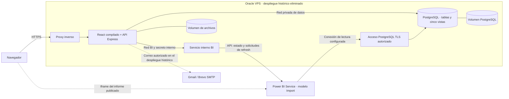
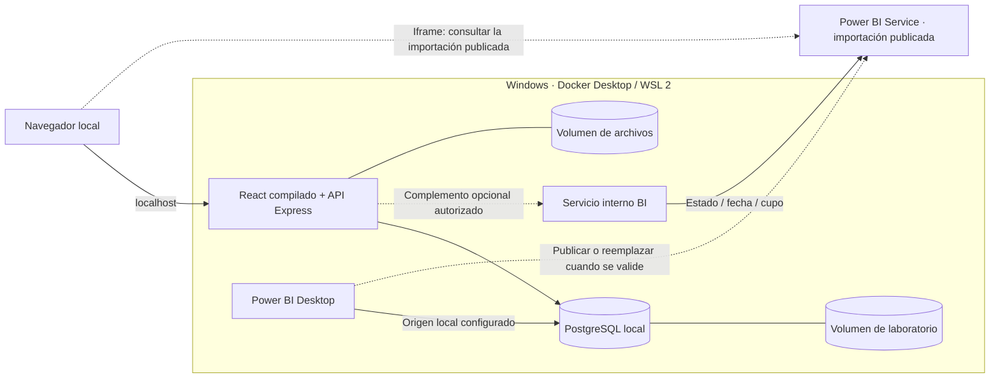

# Arquitectura y operación

**Estado al 22/11/2026:** la instancia Oracle anterior fue eliminada. La demo actual se ejecuta en local. El despliegue VPS de esta página es un antecedente del proyecto, no una web disponible ni una arquitectura cuya restauración se haya validado.

## Componentes y responsabilidades

| Componente | Tecnología | Responsabilidad |
|---|---|---|
| Aplicación | React 19, TypeScript, Vite, Node.js y Express 5 | Catálogo, API, compra simulada, panel y procesos internos |
| Datos | PostgreSQL 18 | Transacciones, claves/restricciones, funciones/triggers, snapshots y cinco vistas |
| Modelo BI | Power BI Desktop, Power Query/M y DAX | Preparación, relaciones, medidas e informes |
| Publicación BI | Power BI Service | Alojar el modelo importado y los informes integrados |
| Servicio interno BI | Node.js y API Microsoft | Consultar estado y controlar solicitudes de actualización; no es un gateway |
| Entrada histórica | Proxy inverso HTTPS | Dirigir al contenedor de aplicación; no ejecutar Power BI |
| Persistencia | Volúmenes Docker | Conservar PostgreSQL y archivos subidos al recrear servicios |

React compilado y Express se sirven desde el mismo contenedor de aplicación. Las vistas están dentro de PostgreSQL. El servicio BI no publica puertos ni entrega tokens al navegador.

## 1. Despliegue histórico en Oracle VPS

En Ubuntu, Docker Compose coordinaba app, PostgreSQL y servicio BI. La app se conectaba a las redes privadas de datos y BI y a la red del proxy compartido. El navegador entraba por HTTPS al proxy. Power BI Service tenía una conexión PostgreSQL TLS de lectura, configurada por separado del acceso web.

Los datos seguían este recorrido: acción del cliente → API/transacción → tablas e historial → vistas → importación y Power Query → medidas DAX → informe publicado. Los correos eran efectos externos reales y requerían verificación/consentimiento según el evento; la compra seguía siendo simulada.

No se copiaba la base al navegador ni se exponía el token Microsoft para mostrar un informe. Las credenciales de lectura de PostgreSQL y la autorización del servicio BI eran distintas. Borrar la instancia eliminó ese origen disponible: que el informe publicado siga visible no restaura la VPS.

## 2. Demo local actual

Docker Desktop con WSL 2 ejecuta app y PostgreSQL de laboratorio. Los puertos se enlazan únicamente a 127.0.0.1. El Compose local tiene proyecto/red/volúmenes propios y se inicializa con esquema, población sintética y vistas solo si el volumen está vacío.

La configuración base desactiva SMTP/Brevo y no requiere Microsoft para usar la tienda. El complemento BI es opcional, con autorización privada y sin puerto publicado. No restablece por sí mismo el origen de datos de Service.

### Tres operaciones distintas

| Operación | Qué hace | Estado documentado |
|---|---|---|
| Ver el informe integrado | Carga desde Microsoft la importación ya publicada | Comprobado el 21/11 en navegador local |
| Consultar fecha/cupo | El servicio interno llama a la API de Microsoft | Comprobado el 21/11; no solicita un refresh |
| Actualizar Service desde PostgreSQL local | Microsoft debe alcanzar y autenticar el nuevo origen | Pendiente de configurar y validar; no demostrado por las capturas |

Los PBIP privados apuntan al PostgreSQL local para trabajar con Power BI Desktop. Cambiar ese origen en Desktop no cambia automáticamente las credenciales/conexión del modelo que ya existe en Service.

Para que Service lea un origen de la PC que no puede alcanzar directamente, hace falta una conexión mediante gateway compatible. Ese gateway es otro componente: no lo instala el contenedor `powerbi` ni está validado aquí. Alternativamente, se puede actualizar en Desktop y publicar deliberadamente la nueva importación. [Microsoft: gateways de datos](https://learn.microsoft.com/en-us/power-bi/connect-data/service-gateway-onprem).

En **modo Import**, filtros e interacciones consultan los datos importados, no PostgreSQL en tiempo real. [Microsoft: actualización de datos](https://learn.microsoft.com/en-us/power-bi/connect-data/refresh-data).

## 3. Recorrido cliente → operación → análisis

1. **Catálogo y carrito:** producto/combinación, cantidad y precio validado por servidor.
2. **Checkout:** domicilio o retiro, cotización y cupón cuando aplica. El sistema distingue envío desconocido, costo cero y retiro.
3. **Pago académico:** intento, confirmación o cancelación simulados; no se cobra ni se guarda una tarjeta real. La captura de pago no acredita una compra completada.
4. **Pedido e inventario:** confirmación y detalles conservados; confirmar pedido no siempre significa cobrado, como en contra entrega.
5. **Entrega:** domicilio PREPARANDO → EN_TRANSITO → ENTREGADO; retiro PREPARANDO → LISTO_RETIRO → RETIRADO, con historial.
6. **Abandono:** plazo de inactividad y último episodio; reactivar no es recuperar una venta. Solo compra posterior entra en recuperación.
7. **BI:** las cinco vistas conservan el grano necesario; Power Query y DAX preparan la lectura del negocio.

Es el comportamiento del proyecto privado. Las evidencias de noviembre cubren navegación, administración e integración indicada, no una nueva prueba completa de compra/cobro/entrega/correo.

## 4. Persistencia, validación y privacidad

Se documentaron arranque, respuesta HTTP y persistencia tras detener/reiniciar. Una prueba stop/up no equivale a restaurar un respaldo ni a recuperar una instancia Oracle. Los SQL iniciales no se vuelven a ejecutar para actualizar una base con datos.

El servicio BI controla concurrencia y un cupo de solicitudes por modelo. Un 8/8 disponible no demuestra que el origen esté conectado ni que un refresh vaya a completar. La última actualización exitosa de las capturas es del **19/10/2026 UTC**, anterior a la recuperación local.

Los informes se incrustan mediante **Publicar en la web**: estar dentro del admin no convierte esa publicación en privada. Por eso el modelo del caso se limita a datos sintéticos y campos analíticos, sin identidades ni documentos de clientes. [Microsoft: alcance público de esa publicación](https://learn.microsoft.com/en-us/power-bi/collaborate-share/service-publish-to-web).

La implementación, las instrucciones de instalación, los PBIP y la configuración operativa están en el repositorio privado. Este caso público aporta documentación, agregados y [capturas](EVIDENCIAS.md), sin afirmar disponibilidad de servicios que fueron eliminados.
