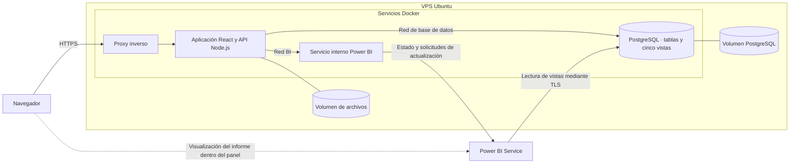
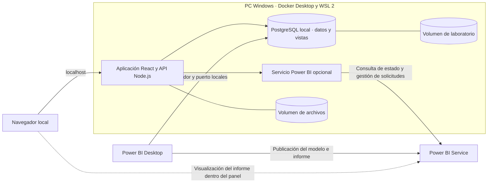

# Arquitectura y operación

## Qué componentes forman la solución

La solución separa la operación del e-commerce, el almacenamiento y el análisis. Docker Compose coordina los servicios; Power BI prepara y presenta los indicadores a partir de las vistas PostgreSQL.

| Componente | Tecnología | Responsabilidad |
|---|---|---|
| Aplicación | React 19, TypeScript, Vite, Node.js y Express 5 | Catálogo, compra simulada, API y panel administrativo |
| Base de datos | PostgreSQL 18 | Operaciones, relaciones, reglas y cinco vistas analíticas |
| Servicio interno BI | Node.js y API de Power BI | Consulta de fecha/cupo y gestión de solicitudes de actualización de cada modelo |
| Preparación y modelo BI | Power BI Desktop, Power Query y DAX | Limpieza, tipos, columnas, relaciones, medidas y diseño de informes |
| Publicación | Power BI Service | Modelos importados e informes integrados en el panel |
| Entrada al despliegue | Proxy inverso | Recepción de conexiones HTTPS y envío de tráfico a la aplicación |
| Persistencia | Volúmenes Docker | Conservación de la base y de archivos subidos |

React y la API se sirven desde el contenedor de aplicación en la versión compilada; no se presentan como dos contenedores independientes. Las vistas pertenecen a PostgreSQL, no a otro servicio.

## 1. Despliegue en VPS

La VPS Ubuntu aloja los servicios Docker. El navegador entra por HTTPS al proxy, que dirige la solicitud a la aplicación. La API consulta PostgreSQL por la red interna. El panel integra los informes alojados en Power BI Service; el servicio interno BI administra las consultas de estado y las solicitudes de actualización.

### Recorrido de una operación y del análisis

1. El usuario navega por el catálogo y realiza acciones del proceso de compra simulado.
2. La API registra esas acciones y sus estados en PostgreSQL.
3. Las vistas analíticas exponen los campos necesarios sin incorporar identidades de clientes al modelo de análisis.
4. Al actualizar el modelo, Power BI importa los datos del origen configurado y aplica las transformaciones y medidas.
5. El administrador consulta el informe publicado dentro del panel; los filtros operan sobre el modelo importado.

El proxy es un componente del despliegue compartido por la red de entrada; el Compose de la aplicación se conecta a esa red. La base usa una conexión de lectura específica para BI. El servicio BI no publica su puerto ni envía tokens al navegador.

## 2. Ejecución local

En Windows, Docker Desktop con WSL 2 ejecuta la aplicación y PostgreSQL en una red de laboratorio. El navegador accede mediante localhost. La base utiliza un volumen propio y se inicializa con esquema, población sintética y vistas solamente cuando ese volumen está vacío.

### Dos tareas distintas en local

- **Trabajar los datos:** Power BI Desktop se conecta al PostgreSQL local para actualizar consultas, revisar el modelo y trabajar medidas o visuales.
- **Consultar el informe integrado:** el navegador carga la versión publicada en Microsoft dentro del panel. El servicio BI opcional permite consultar su fecha y cupo mediante la API.

Para que Power BI Service actualice una base accesible únicamente desde la PC, se configura un gateway de datos local. La conexión Desktop y la conexión del modelo publicado se configuran por separado. [Referencia de Microsoft sobre gateways](https://learn.microsoft.com/en-us/power-bi/connect-data/service-gateway-onprem).

## 3. Qué cambia entre entornos

| Aspecto | VPS | Local |
|---|---|---|
| Entrada a la aplicación | HTTPS mediante proxy | Navegador y puertos de localhost |
| Base | PostgreSQL del servidor | PostgreSQL de laboratorio en Docker |
| Credenciales y datos | Propios del despliegue | Propios de la PC, separados del servidor |
| Acceso del modelo BI | Conexión de lectura al servidor | Conexión Desktop local; gateway si Service necesita acceder al origen privado |
| Persistencia | Volúmenes del servidor | Volúmenes de laboratorio |
| Informe dentro del panel | Informe publicado en Microsoft | Informe publicado en Microsoft |

En ambos casos se utiliza **modo Import**. Interactuar con un filtro no significa consultar PostgreSQL en tiempo real: los datos cambian al actualizar el modelo. La fecha visible del panel identifica esa actualización.

## 4. Operación y comprobaciones

Los contenedores tienen comprobaciones de salud, límites de memoria y rotación de logs. Los servicios de aplicación y base se coordinan para que la aplicación espere a PostgreSQL. Los volúmenes conservan los datos al detener y recrear contenedores.

Se verificaron arranque, respuesta HTTP, persistencia tras detener/reiniciar, integración de ambos informes, filtros y consulta de estado. La integración no requiere que las credenciales de PostgreSQL o Microsoft estén en el repositorio público.

Este repositorio presenta el caso y sus evidencias. La implementación, las instrucciones de ejecución y la configuración operativa permanecen en el repositorio privado. La [galería](EVIDENCIAS.md) muestra las pantallas del entorno utilizado.
