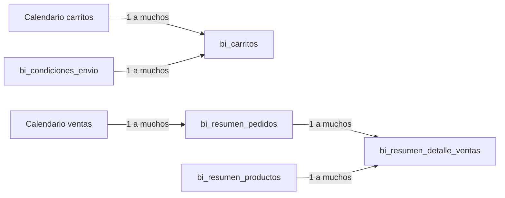

# Datos y reglas del análisis

## Pregunta que guía el modelo

¿En qué etapas se abandona la compra, y cómo se relacionan el subtotal y el costo de envío mostrado, incluido el umbral de envío gratuito, con la finalización del pedido?

El análisis usa un histórico sintético de enero de 2024 al 13 de octubre de 2026. Se separa de las pruebas nuevas del prototipo mediante `origen_datos`. Octubre es parcial y los patrones de abandono se incorporaron deliberadamente al generador.

## Granularidad de las vistas

| Vista | Una fila por | Uso |
|---|---|---|
| `bi_carritos` | Carrito | Etapas, estado, fechas, cotizaciones y pedido |
| `bi_condiciones_envio` | Condición histórica de envío | Umbral y política asociada |
| `bi_resumen_pedidos` | Pedido | Importes de cabecera y estados |
| `bi_resumen_detalle_ventas` | Línea de pedido | Cantidad e importe de cada línea |
| `bi_resumen_productos` | Variante de producto | SKU, producto, categoría y franquicia |

Mantener cabecera y líneas separadas evita repetir el total de un pedido por cada artículo. Las ventas históricas no se reconstruyen con el precio actual del catálogo.

## Definiciones de los indicadores

| Indicador | Regla | Denominador de la tasa |
|---|---|---|
| Con abandono | Fecha de abandono no vacía, aunque después compre | Todos los carritos del contexto |
| Llegada a checkout | Fecha de inicio de checkout no vacía | Todos los carritos del contexto |
| Inicio de pago | Fecha de inicio de pago no vacía | Todos los carritos del contexto |
| Conversión | Pedido asociado | Todos los carritos del contexto |
| Recuperación | Pedido y compra posterior o igual a la fecha de abandono | Carritos con abandono |

El panel operativo también muestra el **estado actual** y el **número de episodios** de abandono. El modelo analítico trabaja una fila por carrito y usa su último abandono registrado; no cuenta cada episodio como si fuera un carrito nuevo.

## Importe y envío de análisis

Si el carrito tiene abandono registrado, uso subtotal, envío y método de entrega guardados en ese momento. En caso contrario, uso los del checkout. No sustituyo esos valores por los de una compra posterior, porque cambiaría lo que se mostró al abandonar.

El umbral se obtiene de la condición histórica del carrito. Lo comparo con el subtotal de análisis en tres grupos: por debajo, exactamente en y por encima. Si falta el subtotal o el umbral, el caso no es comparable. No confundo estos grupos con rangos fijos como menos de $25 o $25-$34.99.

Para los gráficos de subtotal, umbral y costo de envío, el informe limita la comparación a entrega a domicilio con cotización conocida. Retiro no representa el beneficio de envío gratuito y `NULL` no significa costo cero.

## Preparación de datos y trabajo en Power BI

El recorrido de trabajo conecta las prácticas del curso con el caso:

| Paso | Trabajo realizado | Ejemplo verificable en el proyecto |
|---|---|---|
| Modelado relacional | Definir tablas, relaciones y qué conservar de cada evento | Carritos, pedidos, líneas y condiciones históricas de envío |
| Entrada de datos | Utilizar CSV y conectar Power BI directamente a PostgreSQL | Importación y exportación de CSV; cinco vistas como origen del modelo |
| Limpieza en Power Query | Limpiar/recortar texto y normalizar tipos | Estados, segmentos, fechas e importes monetarios |
| Columnas personalizadas | Preparar campos según reglas del análisis | Elegir la cotización guardada al abandonar o la del checkout |
| Columnas calculadas | Clasificar datos dentro del modelo | Rangos de subtotal y relación con el umbral histórico |
| Relaciones | Respetar claves y granularidad | Calendario, pedidos, detalle y variantes |
| Medidas DAX | Definir cantidades y tasas con un denominador explícito | Abandono, conversión, avance y recuperación |
| Visualización | Relacionar cada pregunta con un visual | Tarjetas, barras, columnas agrupadas y evolución mensual |
| Comunicación | Interpretar el indicador y plantear una decisión evaluable | Piloto de envío gratuito desde $25 con métricas de conversión y costo |

El CSV es un formato de intercambio y exportación; los informes de este caso utilizan las vistas PostgreSQL como origen. Una vista SQL, una columna de Power Query y una medida DAX cumplen funciones diferentes y se explican por separado.

## Mapa de preguntas y visuales

| Pregunta | Visual principal del informe Carritos |
|---|---|
| Evolución | «Carritos con abandono y convertidos por mes» |
| Etapa de abandono | «¿En qué etapa abandonan?» |
| Avance y pedido | Tarjetas de llegada al checkout, inicio de pago y conversión |
| Subtotal y umbral | «Abandono y conversión por subtotal» y «Comparación con el umbral de envío gratuito» |
| Costo de envío | «Continuidad según el costo de envío mostrado» |
| Segmentos y períodos | «Clientes nuevos y recurrentes» y evolución mensual |
| Recuperación | Tarjetas «Carritos recuperados» y «Tasa de recuperación» |

Las barras por etapa son horizontales simples y las de clientes comparan series agrupadas. Las comparaciones de subtotal, umbral y envío usan columnas agrupadas: no se apilan abandono y conversión como partes de un mismo total.

## Preparación e interpretación

Power Query prepara texto, importes, fechas y snapshots de análisis. El modelo define las relaciones con los calendarios y DAX calcula las medidas. Las comparaciones por período utilizan la fecha de creación del carrito; otra cohorte requeriría indicarlo expresamente.

Abandono y conversión se solapan, por lo que sus tasas no se suman como partes de un total. Confirmar un pedido simulado no equivale a un cobro real. Las ventas netas de productos excluyen envío y no representan utilidad: faltan costos históricos y gastos para calcularla.

Los [hallazgos vigentes](HALLAZGOS_Y_RECOMENDACIONES.md) se recalcularon sobre el histórico local con estas reglas; las capturas Power BI conservan su importación anterior.

## Formato y trazabilidad

En los documentos uso coma para miles y punto para decimales: 42,900 carritos, 70.95 % y $34.99. En los CSV los conteos se guardan sin separadores de miles y los decimales usan punto, para permitir una importación consistente.

Los porcentajes citados como visibles mantienen el redondeo del dashboard. Los cálculos derivados y los conteos contrastados en SQL se identifican en [Hallazgos y recomendaciones](HALLAZGOS_Y_RECOMENDACIONES.md). No se combinan conteos de una versión con porcentajes de otra para reconstruir cantidades.

## Relaciones y ejemplos DAX del modelo



Las relaciones filtran en una dirección. La fecha de análisis del abandono es la **creación del carrito**, no el día en que se detectó la inactividad. El calendario de ventas usa fecha de compra. No se añade otra relación directa de fecha al detalle que duplique el recorrido del filtro.

Ejemplos de medidas utilizadas, con una fila por carrito:

```dax
Total carritos = COUNTROWS(bi_carritos) + 0
Carritos con abandono = COUNT(bi_carritos[fecha_abandono]) + 0
Pedidos confirmados = COUNT(bi_carritos[id_pedido]) + 0
Porcentaje con abandono = DIVIDE([Carritos con abandono], [Total carritos])
Porcentaje de conversion = DIVIDE([Pedidos confirmados], [Total carritos])
```

La recuperación añade abandono no vacío y `fecha_compra >= fecha_abandono`. Los porcentajes se evalúan en el contexto de filtros, no contra un total global fijo.

En Resumen, cuando el filtro llega desde producto, los pedidos se cuentan distintos desde las líneas. Las ventas netas por línea distribuyen proporcionalmente el descuento de cabecera mediante `RELATED`/`DIVIDE`; así no se repite el descuento completo por cada artículo. No se activa filtro bidireccional para ocultar un problema de granularidad.

## Fuente de cifras y comprobación reproducible

Los CSV de `datos/` son agregados del corte local del 21/11/2026. `totales.csv` es la referencia de la cohorte: los demás archivos son desgloses que deben reconciliar con ella, o subconjuntos explícitos de domicilio con cotización conocida. `umbral.csv` no incluye una fila exactamente en el umbral porque no hay casos; la tabla del análisis lo señala como ausencia de observaciones.

El validador `node scripts/validar-caso.mjs` comprueba sumas, denominadores, límites de conteos, correspondencia entre subconjuntos y enlaces locales del repositorio. No vuelve a consultar PostgreSQL ni demuestra la conectividad actual con Microsoft. Las cifras de los modelos publicados se identifican aparte en Evidencias; no se sustituyen sus capturas por resultados locales.
