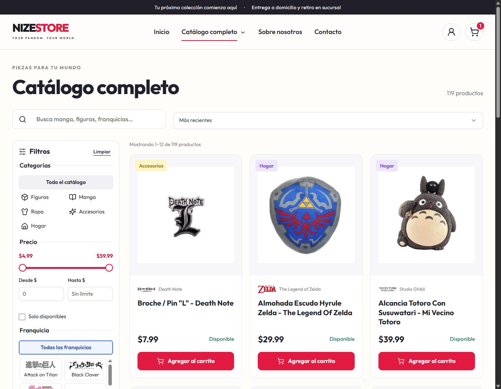
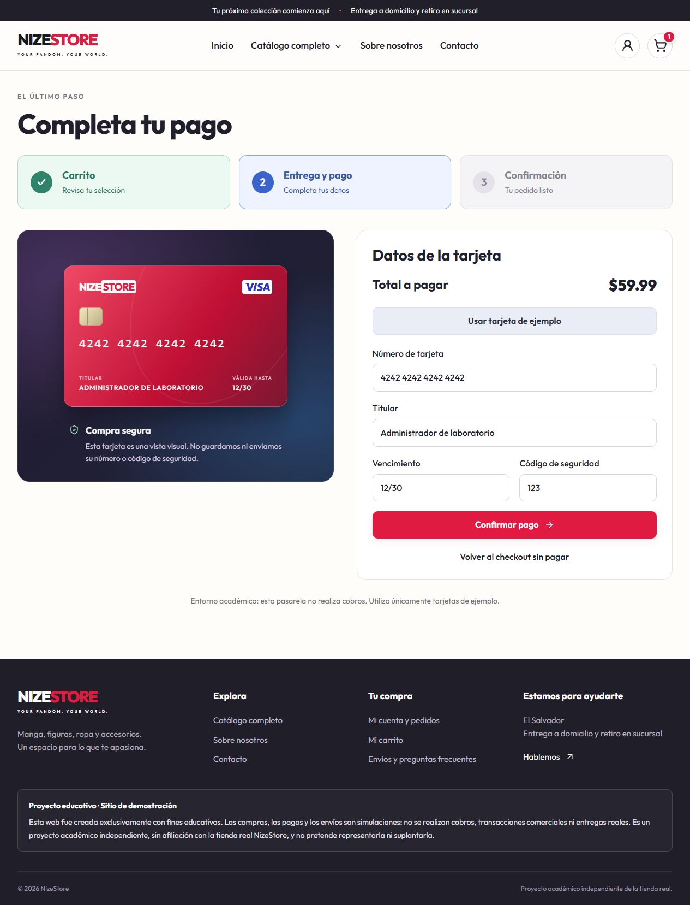
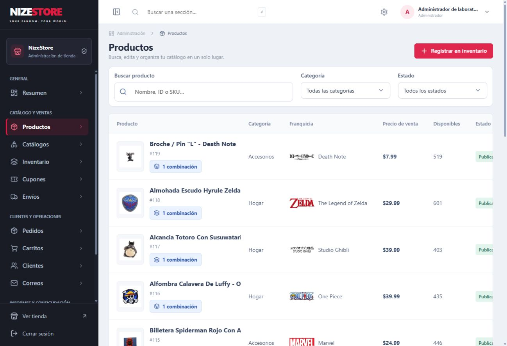
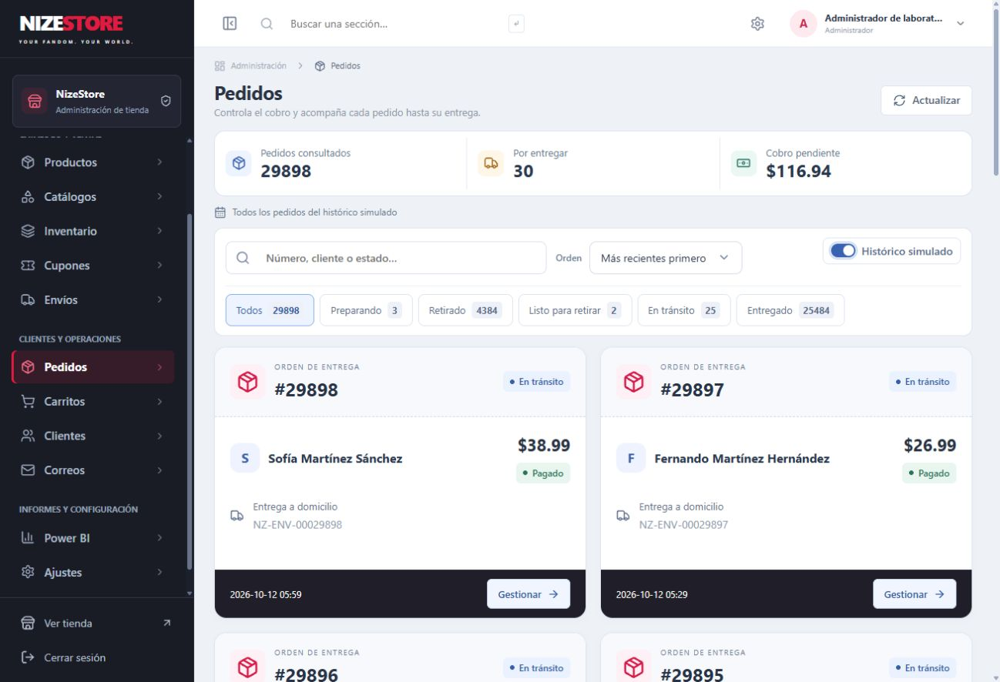
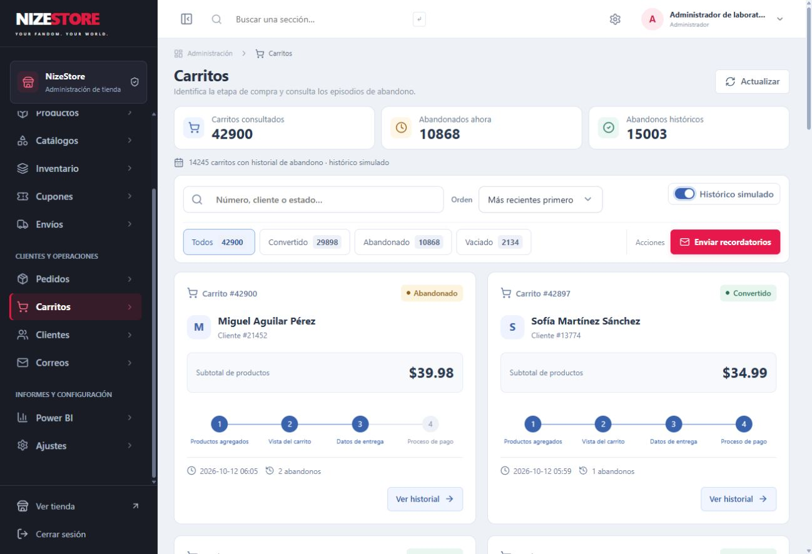
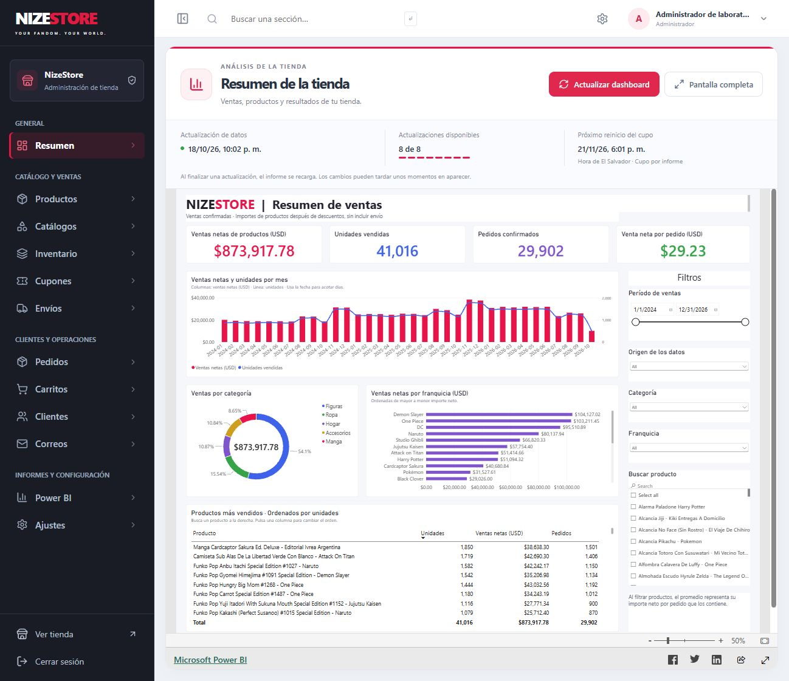
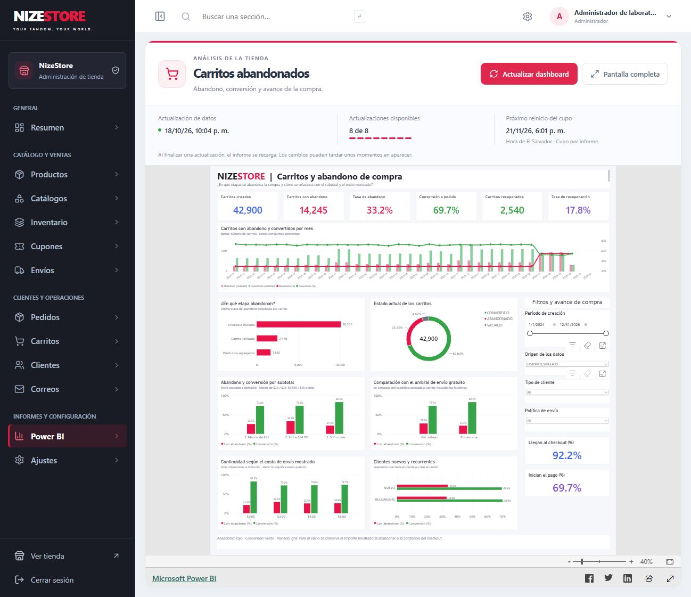
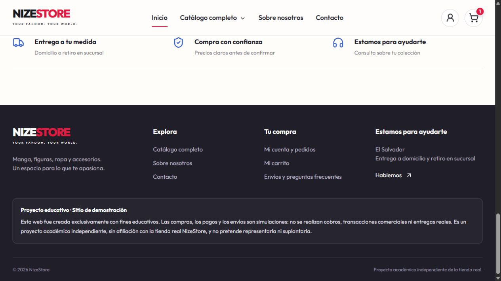

# Galería y fuentes del caso

## E-commerce

### Inicio y categorías

Captura local del 21/11/2026. Incluye la cabecera, la presentación y las cinco categorías. El prototipo conserva referencias y recursos de terceros, sin afiliación con una tienda real ni atribución de esos recursos como creación propia.

### Catálogo

Catálogo de 119 productos de demostración, con búsqueda, filtros, precios, disponibilidad y acciones del carrito. Captura local del 21/11/2026.

### Pago simulado

Se usó la tarjeta de ejemplo de la aplicación y la cuenta de laboratorio. No se utilizaron datos financieros reales ni se pulsó Confirmar pago. Se regresó al checkout sin pagar. La imagen es estática; la interfaz original incluye una tarjeta animada.

## Administración y análisis con Power BI

### Productos

Vista real del catálogo administrativo: producto, categoría, franquicia, precio y existencias. No se alteraron productos para realizar la captura.

### Pedidos

Histórico simulado activado: 29.898 pedidos. La vista muestra estados de cobro y entrega; los nombres y operaciones visibles pertenecen al laboratorio.

### Carritos

Histórico simulado activo: 42.900 carritos, 10.868 abandonados actualmente, 15.003 episodios históricos y 14.245 carritos distintos con historial. Es un panel operativo web, separado del informe analítico Power BI que aparece abajo.

### Resumen de ventas integrado

Informe publicado en Microsoft y cargado dentro del panel local, con la navegación administrativa visible. Origen seleccionado: Todas. Conserva $873.917,78 en ventas netas de productos, 41.016 unidades y 29.902 pedidos de una importación anterior con histórico y pruebas del prototipo. No representa ventas reales ni el total del histórico local usado para las conclusiones.

### Carritos y abandono integrado

Informe publicado cargado dentro del panel local, con origen HISTORICO_SIMULADO, todos los segmentos y políticas. Se seleccionó Ajustar a la página para mostrar el dashboard completo sin retirar el menú administrativo. Se verificaron 42.900 carritos, 14.245 con abandono y 2.540 recuperados.

Los totales y las etapas coinciden con la comprobación SQL local. La distribución por tarifas conserva la importación anterior y presenta pequeñas diferencias: por ejemplo, para envío de $3 el informe muestra aproximadamente 72,2 % de conversión y el recálculo local da 72,02 %. Las tablas del [análisis vigente](HALLAZGOS_Y_RECOMENDACIONES.md) y los CSV usan el recálculo local, sin mezclar versiones.

### Estado comprobado de la integración

El 21/11/2026 se comprobaron ambos informes dentro del panel y la consulta de su estado mediante el servicio interno autorizado. Microsoft devolvió las últimas actualizaciones completadas del 19/10/2026 UTC; el panel las muestra en hora de El Salvador como 18/10/2026 por la noche. El cupo consultado fue 8/8 para cada modelo.

Se comprobó la visualización interactiva, los filtros y la consulta de fecha/cupo. Las capturas muestran los datos del modelo publicado en Microsoft. La conexión de Power BI se configura según el origen utilizado: PostgreSQL en la VPS o PostgreSQL local. Los [detalles de conexión y actualización](ARQUITECTURA_Y_OPERACION.md) explican esa diferencia.

El selector de fechas llega a diciembre de 2026, pero el histórico generado termina el 13 de octubre. La amplitud del calendario no prueba que existan operaciones hasta diciembre.

## Aviso académico

Identifica las compras, pagos y envíos como simulaciones y declara ausencia de afiliación con la tienda real. Se conserva esta captura anterior del 20/11/2026.

## Fuentes y alcance

Las capturas nuevas son del entorno local del 21/11/2026; la pantalla de pago y el aviso se conservaron de las evidencias ya revisadas. No se publican sesiones, contraseñas, autorización Microsoft ni archivos operativos privados.

Los [CSV públicos](../datos/) contienen únicamente agregados del histórico local: totales, etapas, períodos, segmentos, umbral y envío. Las consultas fueron de solo lectura y excluyeron pruebas del prototipo. Un campo vacío de envío significa valor desconocido, no costo cero.

El material académico anterior sirve como antecedente de la evolución del proyecto. Las conclusiones actuales responden al enfoque delimitado de etapas, subtotal, envío, umbral y recuperación; no reutilizan conclusiones anteriores sobre dispositivos o fallos de pago.

La implementación privada conserva la validación previa de tipos, compilación, 95 pruebas, construcción de contenedores y persistencia. La integración de este corte se verificó con configuración Compose, salud de los servicios, API oficial de estado y navegador real.
