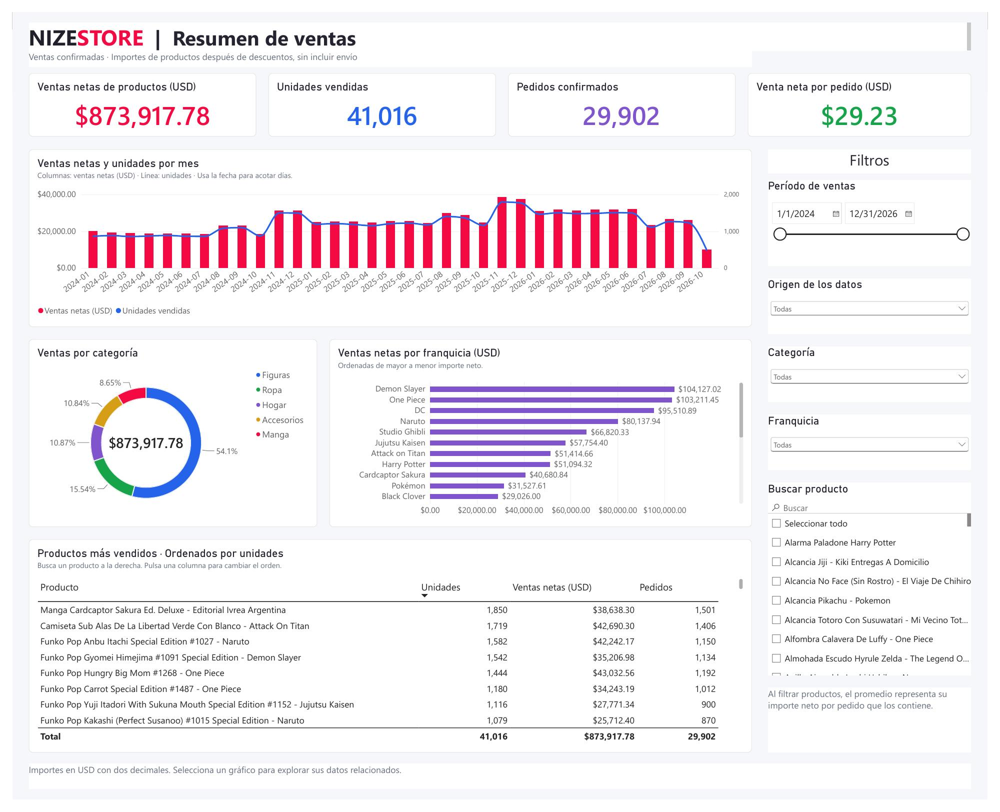
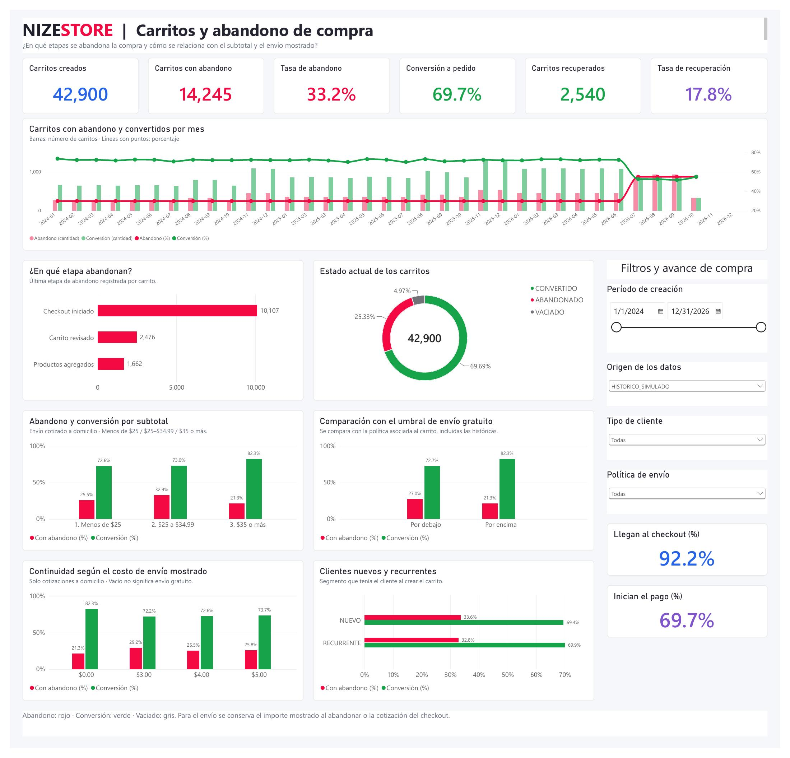
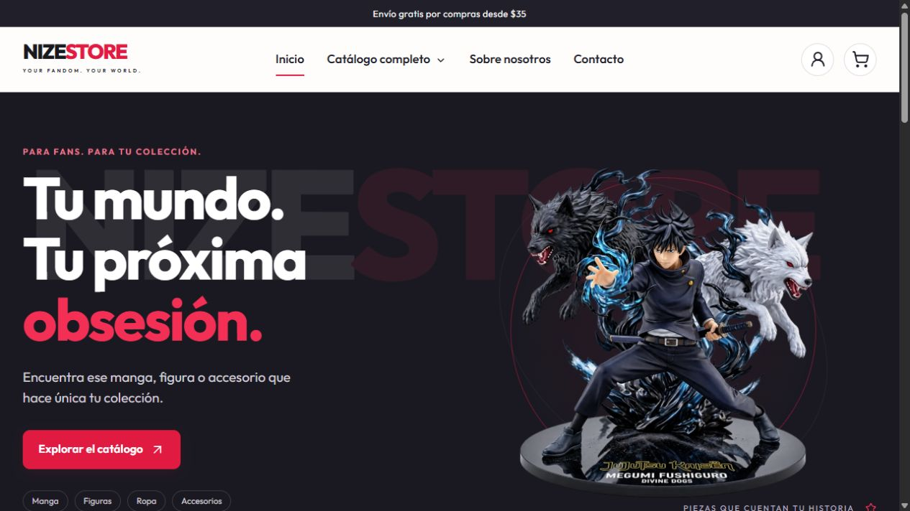
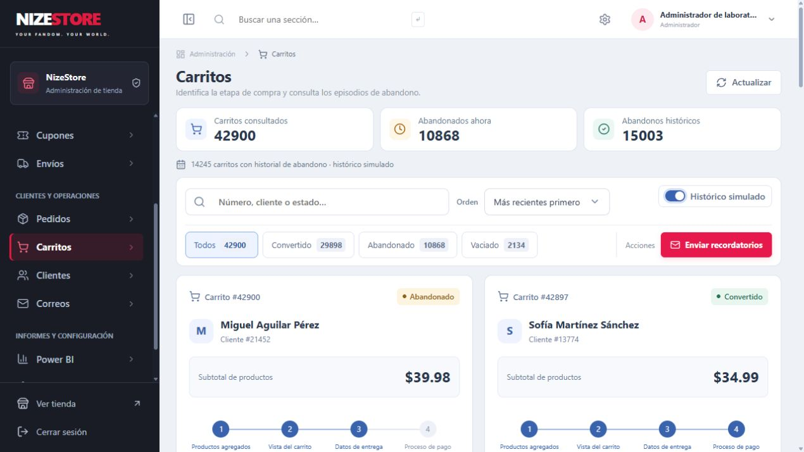
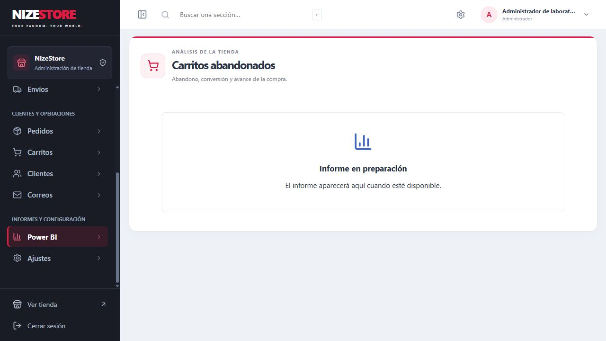

# Galería y fuentes del caso

## Análisis con Power BI

Abrí los informes originales en Power BI Desktop y exporté sus páginas el 21/11/2026. Las imágenes muestran el diseño y los datos importados que conservaban los archivos; no se actualizaron sus conexiones ni se guardaron cambios sobre los originales.

### Resumen de ventas

Origen seleccionado: **Todas**. La importación conservada muestra $873.917,78 en ventas netas de productos, 41.016 unidades y 29.902 pedidos. Es una fotografía anterior con datos de prototipo además del histórico; no representa ventas reales ni el total del histórico local usado para las conclusiones. El selector de fecha llega a diciembre, pero eso no significa que existan datos hasta diciembre: el histórico de generación termina el 13 de octubre.

### Carritos y abandono de compra

Origen seleccionado: **HISTORICO_SIMULADO**; cliente y política: todos; período visible: enero de 2024-diciembre de 2026, con datos generados solo hasta el 13 de octubre. Se verificaron 42.900 carritos, 14.245 con abandono y 2.540 recuperados. Los totales y las etapas coinciden con la comprobación SQL local.

La distribución por tarifas de envío conserva la importación anterior y presenta pequeñas diferencias frente a la población local actual. Por ejemplo, la imagen muestra 72,2 % de conversión para envío de $3 y el recálculo local da 72,02 %. Las tablas del [análisis vigente](HALLAZGOS_Y_RECOMENDACIONES.md) y sus CSV usan el recálculo local; no mezclo ambas versiones para formular conclusiones.

## E-commerce

### Inicio

Captura de la demo local el 21/11/2026. Presenta el punto de entrada al recorrido de catálogo y compra. El prototipo conserva referencias comerciales y recursos de terceros, sin afiliación ni atribución de esos recursos como creación propia.

### Pago simulado

Captura local el 21/11/2026, con la tarjeta de ejemplo incluida en la aplicación y la cuenta de laboratorio. No se usaron datos financieros reales ni se pulsó Confirmar pago. Se regresó al checkout sin pagar. La imagen es estática; la interfaz original incluye la tarjeta animada.

## Administración

### Seguimiento de carritos

Captura local del 20/11/2026, con histórico simulado activo. El panel distingue 10.868 carritos abandonados actualmente, 15.003 episodios históricos y 14.245 carritos distintos con historial. Los nombres visibles son de laboratorio. Es un panel web, no un informe Power BI.

### Sección Power BI

Captura local del 21/11/2026. Documenta la sección de informes del panel y el mensaje «Informe en preparación». La configuración local tiene deshabilitada la integración Microsoft; esta imagen no demuestra un informe incrustado disponible. El encabezado lateral «Informes y configuración» identifica la navegación, no una pantalla de credenciales.

### Aviso académico

Identifica las operaciones como simuladas y declara ausencia de afiliación con la tienda real.

## Fuentes para los hallazgos

La comprobación del 21/11/2026 utilizó las vistas de la base local y consultas agregadas de solo lectura. Se excluyeron las pruebas del prototipo. Los [CSV públicos](../datos/) contienen únicamente agregados: totales, etapas, períodos, segmentos, umbral y envío. Un campo vacío de envío en el CSV significa valor desconocido, no costo cero.

El material académico previo sirvió para reconstruir la evolución del proyecto y la forma de presentar resultados. Las preguntas vigentes y sus conclusiones corresponden al enfoque delimitado aquí. No se reutilizan hallazgos anteriores de dispositivos, marketing o errores de pago como si fueran resultados del modelo actual.

## Comprobaciones técnicas de apoyo

La implementación privada superó comprobación de tipos, compilación y 95 pruebas, además de construcción de contenedores, salud HTTP y persistencia tras detener y reiniciar servicios. La web se revisó en escritorio. Estas comprobaciones apoyan la ejecución del caso, pero no sustituyen el análisis de negocio ni una auditoría exhaustiva.

Quedan por validar la actualización de los informes contra la base local actual, la integración Microsoft y una eventual demo pública. La persistencia comprobada no equivale a una restauración probada desde respaldo.
